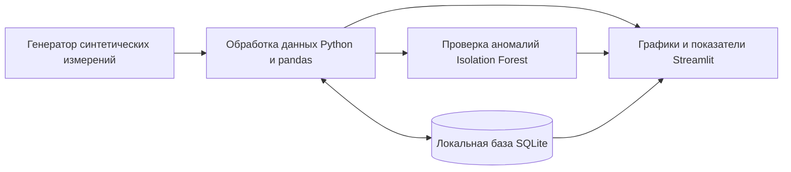

# Интеллектуальная платформа мониторинга электрических подстанций АПК

Демонстрационная веб-платформа для интеллектуального мониторинга технического состояния электрических подстанций агропромышленного комплекса (АПК). Проект показывает, как цифровые инструменты, анализ телеметрии и методы машинного обучения могут использоваться для наблюдения за электротехническими параметрами, выявления отклонений и планирования технического обслуживания.

<p align="center">
  <a href="https://substation-apk-monitoring-esoffias.streamlit.app/">
    <strong>ОТКРЫТЬ РАБОТАЮЩУЮ ПЛАТФОРМУ</strong>
  </a>
</p>

<p align="center">
  <a href="https://substation-apk-monitoring-esoffias.streamlit.app/">Демонстрационная версия на Streamlit</a>
  ·
  <a href="https://github.com/esoffias/substation-apk-monitoring-esoffias">Исходный код на GitHub</a>
</p>

---

## О проекте

Электроснабжение ферм, элеваторов, птицефабрик и других объектов агропромышленного комплекса зависит от надёжной работы электротехнического оборудования. Изменение тока, напряжения или температуры может указывать на отклонения в работе оборудования и необходимость дополнительной проверки.

Цель проекта — представить в интерактивном виде концепцию интеллектуальной платформы мониторинга электрических подстанций АПК. Пользователь может просматривать условные измерения, анализировать графики, проверять наборы параметров с помощью алгоритма обнаружения аномалий, моделировать аварийный сценарий и вести техническую историю оборудования.

**Важно:** опубликованная версия является учебным демонстрационным прототипом. Она не подключена к реальным датчикам, SCADA-системам, релейной защите или исполнительным механизмам. Измерения и аварийные сценарии в приложении моделируются программно.

## Возможности платформы

### 1. Мониторинг

- Выбор одного из трёх демонстрационных объектов: ферма «Рассвет», элеватор «Заря» и птицефабрика «Юг».
- Отображение основных электротехнических параметров: тока нагрузки (А), напряжения сети (В) и температуры оборудования (°C).
- Просмотр временных графиков и ориентировочных диапазонов значений.
- Подробный анализ выбранного параметра за определённый период.
- Просмотр статистики: количество измерений, минимальное, среднее и максимальное значения.
- Выделение точек, попадающих за заданные демонстрационные пороги.
- Отображение результата проверки последнего набора показателей алгоритмом Isolation Forest.
- Запуск и сброс программного аварийного сценария.

### 2. Симулятор параметров

Симулятор позволяет самостоятельно задать значения:

- тока нагрузки — от 0 до 100 А;
- напряжения сети — от 300 до 450 В;
- температуры оборудования — от 0 до 150 °C.

После проверки платформа сопоставляет выбранные значения с условным профилем, выполняет обнаружение аномалии и показывает результат с учётом демонстрационных предупредительных и критических порогов.

### 3. Архив и техническое обслуживание

Раздел объединяет четыре инструмента:

- **История измерений** — фильтрация телеметрии по объекту, параметру и диапазону дат, график и статистика, выгрузка выбранных данных в CSV.
- **История ремонтов** — регистрация даты и причины ремонта, выполненных работ, ответственного инженера и результата проверки.
- **Реестр оборудования** — учёт наименования, производителя, модели, заводского номера, даты установки, срока эксплуатации и контактов производителя. Плановая дата замены рассчитывается по дате установки и заданному сроку службы.
- **Журнал событий** — просмотр зарегистрированных событий с фильтром по объекту и экспортом в CSV.

### 4. Документация

В приложении доступны справочные материалы:

- функциональные требования F-01—F-12;
- нефункциональные требования NF-01—NF-05;
- описание предполагаемых ролей диспетчера и инженера;
- справочник электротехнических и программных терминов;
- правила использования демонстрационной платформы и ограничения прототипа.

## Принцип работы и архитектура

В текущей версии реализован демонстрационный поток обработки данных:



Основные логические уровни концепции:

1. **IoT** — предполагаемый уровень получения данных от датчиков тока, напряжения, температуры и других диагностических устройств. В прототипе реальные датчики не подключены.
2. **Pipeline** — передача и подготовка телеметрии. В демонстрационной версии обработка выполняется внутри Python-приложения.
3. **AI Core** — аналитический модуль для обнаружения статистически нетипичных сочетаний параметров.
4. **UI** — пользовательский интерфейс с карточками показателей, графиками, архивом и журналом событий.

## Используемые технологии

| Технология | Назначение |
|---|---|
| Python | Основной язык приложения |
| Streamlit | Веб-интерфейс и интерактивные элементы |
| pandas | Обработка и анализ табличных данных |
| NumPy | Генерация и математическая обработка демонстрационных данных |
| Plotly | Интерактивные графики |
| scikit-learn | Алгоритм обнаружения аномалий Isolation Forest |
| SQLite | Локальное хранение телеметрии, событий, ремонтов и оборудования |
| Pillow | Создание иконки приложения |

## Модуль обнаружения аномалий

В прототипе используется алгоритм **Isolation Forest** из библиотеки `scikit-learn`.

Для демонстрации алгоритм обучается на искусственно сгенерированных условно-нормальных примерах, содержащих три параметра: ток, напряжение и температуру. В коде используется ансамбль из 160 деревьев (`n_estimators=160`) и параметр `contamination=0.025`. Созданная модель кэшируется средствами Streamlit, чтобы не обучать её заново при каждом взаимодействии с интерфейсом.

Isolation Forest определяет статистически необычные сочетания входных значений. В текущей версии это **обнаружение аномалий, а не нейросетевой прогноз** даты поломки или остаточного ресурса оборудования. Результат также сопоставляется с демонстрационными пороговыми значениями.

## Данные и база данных

Приложение использует локальную базу SQLite `substation_demo.db`. В ней создаются таблицы:

- `telemetry` — измерения тока, напряжения и температуры;
- `telemetry_archive` — долгосрочный архив измерений;
- `events` — журнал событий;
- `repairs` — записи о ремонтах;
- `equipment` — реестр оборудования.

При первоначальном создании базы формируется синтетическая почасовая история примерно за год для трёх демонстрационных объектов. Для оперативной панели отдельно формируются последние 100 условных точек телеметрии с минутным шагом. Кнопка обновления добавляет измерение в базу данных.

**Ограничение размещения:** Streamlit Community Cloud не гарантирует сохранность данных, записанных в локальные файлы приложения. Поэтому SQLite в этой версии подходит для демонстрации, но не должна использоваться как надёжное постоянное хранилище производственных данных. Для промышленного применения потребуется внешняя база данных с резервным копированием и контролем доступа.

## Запуск проекта локально

### Требования

- Python 3.10 или новее;
- Git;
- зависимости, перечисленные в `requirements.txt`.

### Установка

```bash
git clone https://github.com/esoffias/substation-apk-monitoring-esoffias.git
cd substation-apk-monitoring-esoffias
python -m venv .venv
```

**Windows:**

```powershell
.venv\Scripts\activate
```

**Linux / macOS:**

```bash
source .venv/bin/activate
```

Установка библиотек и запуск:

```bash
python -m pip install -r requirements.txt
streamlit run app.py
```

После запуска приложение будет доступно по адресу `http://localhost:8501`.

## Публикация

Демонстрационная версия размещена на Streamlit Community Cloud и связана с GitHub-репозиторием.

- **Веб-приложение:** https://substation-apk-monitoring-esoffias.streamlit.app/
- **Репозиторий:** https://github.com/esoffias/substation-apk-monitoring-esoffias

## Ограничения и направления дальнейшего развития

Текущий прототип предназначен для демонстрации интерфейса и принципов анализа данных. Для перехода к эксплуатации на реальных объектах потребуются отдельные проектные и инженерные работы:

- подключение реальных датчиков, контроллеров и источников телеметрии;
- разработка защищённого канала передачи и проверки качества данных;
- интеграция с промышленными системами и базой данных с гарантированной сохранностью;
- разработка авторизации и разграничения прав пользователей;
- настройка порогов по паспортным и эксплуатационным данным конкретного оборудования;
- обучение и валидация моделей на репрезентативных реальных данных;
- испытания, оценка безопасности и подтверждение корректности алгоритмов;
- разработка безопасных процедур взаимодействия с системами защиты и управления.

Пороговые значения в приложении являются демонстрационными и **не являются уставками релейной защиты**. Платформа не выполняет реальное отключение, переключение или управление электроустановкой.

## Поисковые темы проекта

Проект посвящён следующим темам: **мониторинг электрических подстанций АПК**, интеллектуальный мониторинг подстанций, искусственный интеллект в энергетике, обнаружение аномалий электротехнических параметров, контроль тока и напряжения, мониторинг температуры оборудования, предиктивное обслуживание электрооборудования, цифровизация агропромышленного комплекса и анализ телеметрии.

## Автор

**Болтикова Софья Александровна**  
GitHub: [@esoffias](https://github.com/esoffias)

---

<p align="center">
  Демонстрационный учебный проект · Интеллектуальный мониторинг электрических подстанций АПК
</p>
